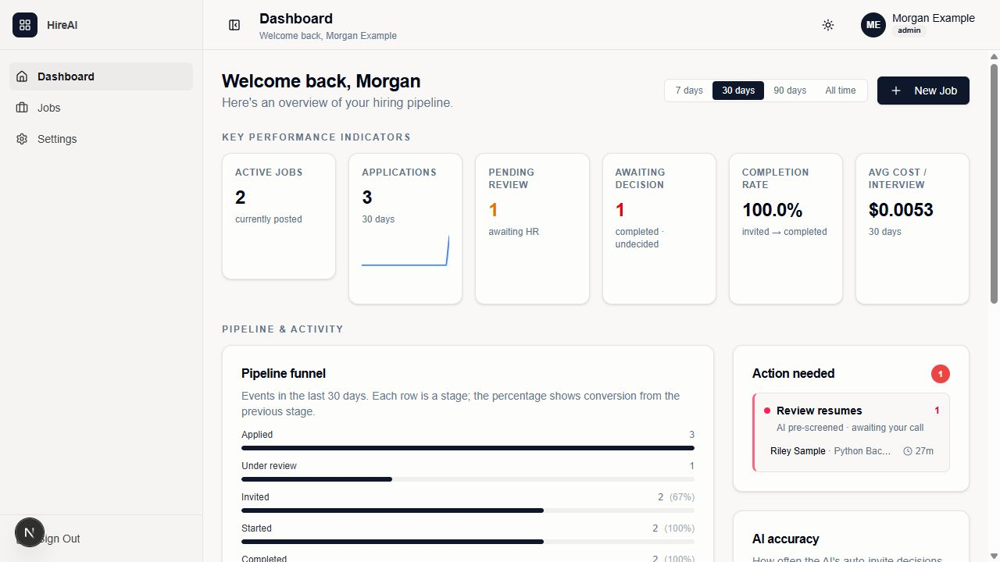
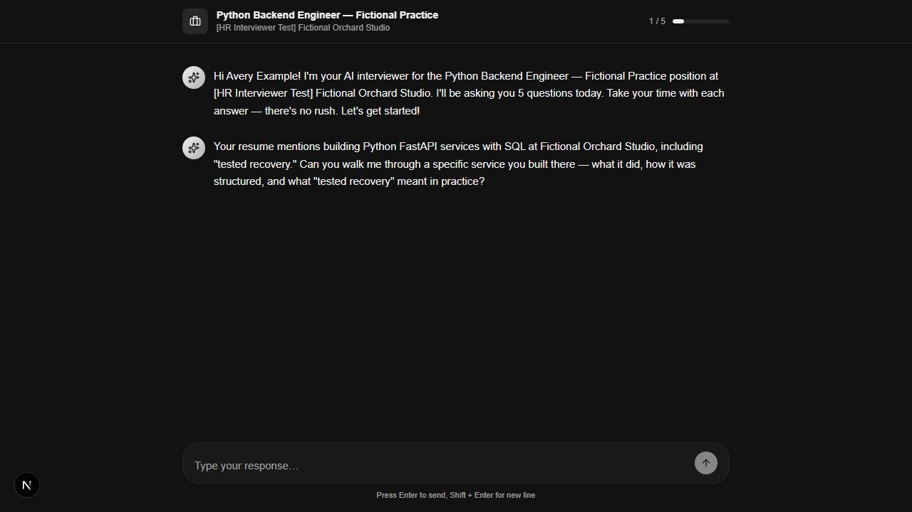
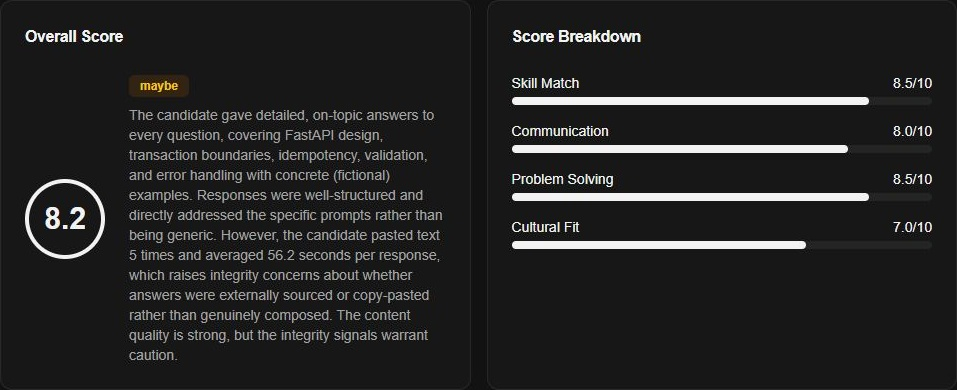
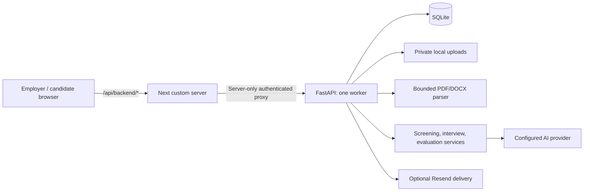

# HR Interviewer

An AI-assisted screening **portfolio prototype**: employers create jobs, review
applications and interviews, and make their own candidate decisions. Candidates
apply with a resume and complete a text interview through an invitation link.
Capabilities include PDF/DOCX resume screening, configurable review policies,
AI-assisted text interviews, saved transcripts and evaluations, shareable reports,
team access, analytics and manual candidate notifications. It is intended for
fictional local evaluation, not production hiring.

## Product screenshots



Fictional candidate data; real DeepSeek responses. Dashboard captured before the
remaining manual decisions; displayed cost is the application's approximate metric.



Fictional candidate data; real DeepSeek responses.



Fictional candidate data; real DeepSeek responses. The assistant supplied fictional
answers; the model's caution is preserved. These results do not validate hiring decisions.
[Screening, transcript, report, analytics and capture provenance](docs/assets/real-provider/README.md).

## How it works

1. **Create a job.** Sign up as a fictional employer, configure the job and its
   screening policy, and copy the application link.
2. **Receive an application.** A candidate opens the link and submits an invented
   PDF/DOCX resume. The backend extracts and screens it with the configured provider.
3. **Review screening.** The policy routes applications to invitation or human
   review. A low score is not automatic rejection; review held applications and
   explicitly approve or reject pre-screening.
4. **Complete the interview.** The candidate follows the prepared interview link
   and answers text questions. The employer can copy that link when email is unavailable.
5. **Make a decision.** Review the saved transcript, evaluation and cautions, then
   shortlist or reject. Status changes do not send email automatically; use
   **Notify candidate** explicitly.

See the [user guide](docs/user-guide.md) for retries, reports, teams and analytics.
Scores and integrity signals require human interpretation and do not validate hiring decisions.

## Start here

| Your goal | Guide |
| --- | --- |
| Configure and run ordinary mode | [Real-provider setup](docs/real-provider-setup.md) |
| Follow the employer/candidate journey | [User guide](docs/user-guide.md) |
| Preview without provider credentials | [Optional fictional demo](docs/portfolio-demo.md) |
| Understand the UI or API | [Frontend](frontend/README.md) / [backend](backend/README.md) |
| Understand architecture and data boundaries | [Architecture](docs/architecture.md) / [data and AI limitations](docs/data-and-ai-limitations.md) |
| Install locked dependencies and run checks | [Tests and quality checks](#tests-and-quality-checks) / [canonical guide](docs/quality-checks.md) |
| Make authorized contributions | [Development workflow](docs/development-workflow.md) / [contributor guidance](CONTRIBUTING.md) |

## Run locally

Verified scope: Windows, Python 3.11.9, Node 22.16.0, npm 10.9.2, uv 0.12.1,
SQLite and one backend worker. From repository root in PowerShell, for a fresh
environment:

```powershell
py -3.11 -m pip install uv==0.12.1
uv venv .venv --python 3.11.9
uv pip sync backend/requirements.lock --python .venv/Scripts/python.exe --require-hashes
npm --prefix frontend ci --fetch-retries=0
.venv/Scripts/python.exe backend/scripts/setup_local.py
```

Preserve existing environments and work; see [canonical installation](docs/quality-checks.md#installation).
Setup refuses to overwrite either environment file. It generates strong private
session/proxy secrets without printing them, chooses a fresh database filename,
and leaves all provider credentials blank.

Edit `backend/.env` privately: the example selects `LLM_PROVIDER=openai` and
`LLM_MODEL=gpt-4.1-mini`; supply `OPENAI_API_KEY`. Review the
[provider/model table and lifecycle notes](docs/real-provider-setup.md#implemented-providers-and-model-configuration)
for DeepSeek and Anthropic alternatives. Keep `PORTFOLIO_DEMO=false` and
`LLM_FALLBACK_PROVIDERS=`. Do not paste keys into chat or commit environment files.
Ordinary usage sends candidate text to the selected provider and may incur charges.

For email, set `RESEND_API_KEY` and a verified `FROM_EMAIL`; leave both blank
for no delivery. Signup/jobs and copied interview links work without email.
Team invitations require delivery. Status emails are manual; automatic completion
notifications are not wired. [Email behavior and retry limits](docs/real-provider-setup.md#email-optional-configuration-and-actual-behavior)
distinguish API acceptance from receipt.

Start the backend after migrating the selected database:

```powershell
Push-Location backend
../.venv/Scripts/python.exe -m alembic upgrade head
../.venv/Scripts/python.exe -m uvicorn app.main:app --host 127.0.0.1 --port 8000 --workers 1 --no-proxy-headers --no-access-log
Pop-Location
```

In a second terminal at repository root:

```powershell
npm --prefix frontend run dev
```

Open `http://localhost:3000`, sign up, create your first job, copy its application
link and submit a fictional resume. Review screening, approve an interview when
needed, complete it and inspect its transcript/evaluation. No demo seed is needed.
The frontend uses `http://127.0.0.1:8000` internally and the shared server-only
proxy secret. Do not run `next dev` or `next start` directly.

Stop each ordinary server with Ctrl+C in its own terminal; ordinary data remains.
Restart both after configuration changes. See the component guides for restart
commands; restarting does not require resetting or seeding a database.

Read the [complete setup, real-mode checks and troubleshooting](docs/real-provider-setup.md)
for provider errors, migrations, storage, email, data disclosure and evidence limits.

## Optional quick preview

Use the [guarded fictional demo](docs/portfolio-demo.md) for a credential-free
preview after locked installation:

```powershell
.venv/Scripts/python.exe backend/scripts/run_portfolio_demo.py start portfolio-1
```

It creates its own database, invented resumes and captured mailbox, uses fixed
synthetic AI responses, and cleans up only its owned resources. It does not prove
live AI quality or email delivery. In another terminal, stop that exact run with
the authenticated launcher:

```powershell
.venv/Scripts/python.exe backend/scripts/run_portfolio_demo.py stop portfolio-1
```

Stop removes the run's owned data and processes. Start a new preview with a fresh
run identifier; do not kill processes using saved PIDs or delete uncertain directories.

The optional [synthetic screenshot gallery](docs/assets/portfolio/README.md)
retains the earlier demo captures with their original provenance.

## Implementation and documentation

### Architecture



The browser calls `/api/backend/*` on [the supplied custom server](frontend/server.mjs).
It removes `/api/backend` and forwards the remaining path to FastAPI on loopback;
for example, `/api/backend/jobs` reaches `/jobs`. The server handles this before
Next page routing. Do not replace it with direct `next dev` or `next start`.

The optional owned demo substitutes synthetic AI and captured email while keeping
real document extraction, application policies and database writes. Background
work and event coordination are process-local, not a durable queue. See the
[architecture guide](docs/architecture.md) for authentication, trust and failure boundaries.

### Tech stack

| Layer | Current implementation |
| --- | --- |
| UI | Next.js 16.4.1 App Router, React 19, TypeScript 5, Tailwind 4, Radix/shadcn components |
| API | FastAPI, Pydantic 2, Uvicorn; exact packages in the hashed Python lock |
| Persistence | SQLAlchemy 2, Alembic, SQLite; local PDF/DOCX uploads |
| Integration | Provider adapters, Resend; deterministic replacements in the owned demo |

Exact dependencies are recorded in the [Python lock](backend/requirements.lock)
and [npm lock](frontend/package-lock.json); the [local setup](#run-locally) lists
the verified runtime versions.

## Repository structure

Selective tracked-source map; component READMEs explain their internal directories.

```text
.
├── README.md
├── AGENTS.md                    # Repository working instructions
├── backend/                     # API, migrations, owned runners, tests
├── frontend/                    # UI and required custom server
├── src/                         # Retained CLI prototype source
├── run_interview.py              # Retained CLI entrypoint
├── run_evaluation.py             # Retained CLI entrypoint
├── data/job_descriptions/        # Tracked sample job description
├── docs/                        # Setup, architecture, usage, evidence
│   └── assets/                  # Screenshots and provenance
├── scripts/                     # Canonical checks and source validation
├── security/                    # Scanner lock and reviewed baseline
├── release/                     # Source allowlist, inventory and digest
├── .github/workflows/            # CI definition
├── RIGHTS.md
├── SECURITY.md
└── THIRD_PARTY_NOTICES.md
```

The retained CLI utilities are not the ordinary web onboarding path. Private
environments, uploads, databases, generated dependencies/builds and ignored
`.local-dev/` records are not supplied source or prerequisites to copy.

## Tests and quality checks

Run these canonical commands from **repository root in PowerShell**, after the
[locked installation](docs/quality-checks.md#installation). Security checks also
need the separate `.security-venv`; browser checks need the locked Chromium install
described there. Use a clean terminal without application/provider overrides.
Installation, the frontend check's clean install and dependency audits need registry access.

| Command | Purpose |
| --- | --- |
| `.venv/Scripts/python.exe scripts/validate_source.py` | Check selected source paths, local links/anchors and content digest. |
| `.venv/Scripts/python.exe scripts/validate_ci.py` | Check workflow/toolchain invariants and metadata regression tests. |
| `.venv/Scripts/python.exe scripts/check.py lint` | Run Python correctness lint. |
| `.venv/Scripts/python.exe scripts/check.py backend` | Run backend tests, disposable SQLite migration checks and credential-free startup. |
| `.venv/Scripts/python.exe scripts/check.py frontend` | Run a clean locked install, lint, strict TypeScript, Node tests and production build. |
| `.venv/Scripts/python.exe scripts/check.py demo` | Verify deterministic HTTP workflows, failures, tenancy and owned cleanup. |
| `.venv/Scripts/python.exe scripts/check.py browser` | Exercise the fictional employer/candidate journey in Chromium through the frontend proxy. |
| `.venv/Scripts/python.exe scripts/check.py dependencies` | Audit dependencies; every finding fails, without exceptions. |
| `.venv/Scripts/python.exe scripts/check.py secrets` | Scan selected current source and available publication-history refs using the reviewed baseline. |

The application tests and demo/browser checks use deterministic fixtures and
provider replacements, require no provider credentials and send no real email.
See [quality checks](docs/quality-checks.md) for isolation, cleanup and scanner
coverage, and [dependency review](docs/dependency-review.md) for tooling rationale and audit commands.

Optional real-provider testing is manual and outside ordinary checks/CI. It
requires explicit provider/model, request and spending approval, exact email
recipients when delivery is tested, and fresh isolated data. Follow the
[real-provider setup and testing guide](docs/real-provider-setup.md); coverage limits are summarized in [data and AI limitations](docs/data-and-ai-limitations.md#verification-coverage).
Deterministic tests do not establish live-provider quality or email delivery.

## Scope and limitations

Verified local environment: Windows, Python 3.11.9, Node 22.16.0, npm 10.9.2,
uv 0.12.1, SQLite and one backend worker. PostgreSQL, Linux/macOS, multiple workers
and hosted real-candidate operation remain unverified. AI scores, evaluations and
integrity signals require human review; they are not validated hiring assessments.
See [data and AI limitations](docs/data-and-ai-limitations.md) and
[architecture boundaries](docs/architecture.md) for details.

## Rights and security

Usage follows [RIGHTS.md](RIGHTS.md): clone, configure, build, test, and run an
unmodified local copy solely for portfolio evaluation. No open-source license is
granted. General modification, business/commercial use, hosting and derivative
products require prior written permission. Third-party terms remain applicable. [Security reporting](SECURITY.md) has no configured private channel by owner decision.
See [third-party notices](THIRD_PARTY_NOTICES.md) and the
[provenance inventory](docs/third-party-inventory.md) for retained terms and evidence limits.
