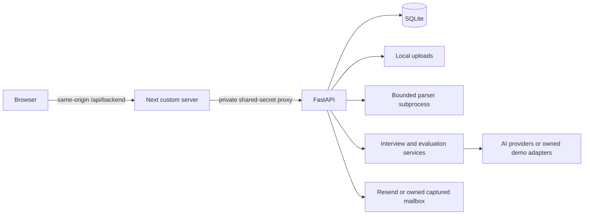

# Architecture

This describes the current local implementation, not the historical SaaS roadmap.
Verified topology: Windows, SQLite, one FastAPI worker, loopback custom Next server.

`frontend/src/app` is the Next.js App Router; `frontend/src/lib/api.ts` uses
the same-origin proxy. `server.mjs` handles proxy requests before Next routing,
strips untrusted identity headers and supplies the actual socket peer plus a
server-only shared secret. FastAPI trusts that identity only from configured
peers with the matching secret. Uvicorn runs with `--no-proxy-headers`.
Extra reverse proxies, public ingress and TLS are outside verified scope.

`backend/app/routers` validates requests and authorization; `services` contains
screening, interviews, evaluation, sharing and delivery logic; `models` and
Alembic define persistence. Cookie JWT authentication, CSRF checks for cookie
mutations, tenant checks and database-role checks protect employer operations.
Public application, interview, team-invite and report links have different
capabilities; do not treat every URL token as a login or as single-use.

Resume uploads are saved locally after bounded size/format checks. A separate
resource-limited process extracts PDF/DOCX text. AI service calls structure and
score content, generate questions/replies and evaluate transcripts. Background
tasks persist their progress. Candidate events use process-local pub/sub for
dashboard updates; per-operation locks are also process-local. SQLite uses WAL
and a busy timeout. None of this constitutes a durable job queue.

The owned demo replaces provider and delivery boundaries, after real document
extraction, while retaining application routes, policies and database writes.
Its supervisor owns child handles, source/build copies, database, uploads and
mailbox. Runtime networking guards deny external destinations; these are not an
OS firewall. Installation/build tools remain a separate network boundary.

Ordinary storage is local even though configuration names mention a cloud storage
provider. No working remote storage path is implied. Redis can share limiter
state but cannot distribute locks, events or background tasks. PostgreSQL and
multi-worker operation require separate verification.

See [data flow and failure limits](data-and-ai-limitations.md),
[setup](../backend/README.md), and [verification scope](quality-checks.md).

## Dashboard metric definitions

The analytics service scopes queries through jobs belonging to the caller's company.
Windows are rolling 7/30/90 days or all time, using inclusive UTC lower bounds.
Applications use candidate creation time, invites use invitation time, and interview
starts/completions use their respective timestamps. Pending review and awaiting
decision are live status counts. Completion rate divides completed interviews by
invitations; a zero denominator returns null. Cost averages use completed interviews.
Per-job health includes average evaluation score and median elapsed completion time.
The awaiting-decision KPI counts all currently completed, undecided candidates;
the separate action list applies its age threshold. The API does not supply
previous-window comparison totals or daily invitation counts, so the dashboard
does not infer comparison percentages or a completion-rate trend from application
counts. The application sparkline shows the supplied daily application totals.
The funnel's shortlisted/rejected counts use candidate completion time and current
status; pre-screen rejections without a completed interview are excluded. These
are not a complete, timestamped history of HR decisions; the candidate list shows
all current statuses, including pre-screen rejection.
Action lists are capped while their counts cover all matching rows. Trends zero-fill
days; the all-time trend is bounded to 180 days. Calibration agreement stays null
below 20 human-reviewed samples and does not establish hiring validity.

The current schema and service define the exact response and query behavior;
update this summary with changes. Historical planning documents are not runtime inputs.
