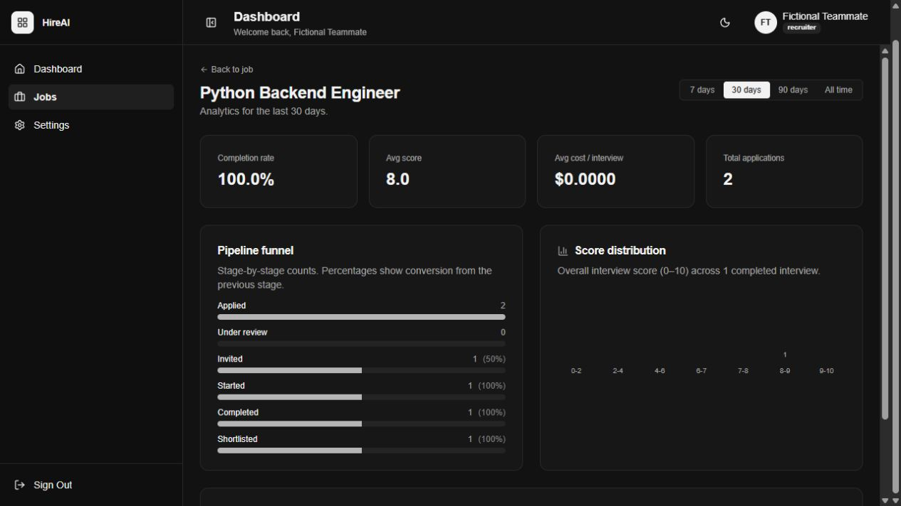
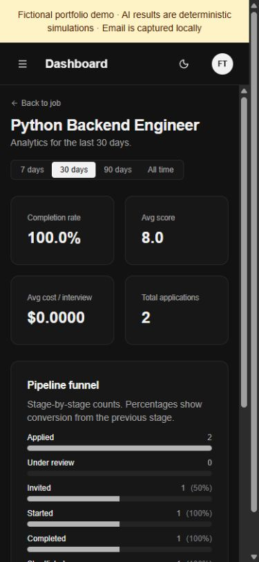
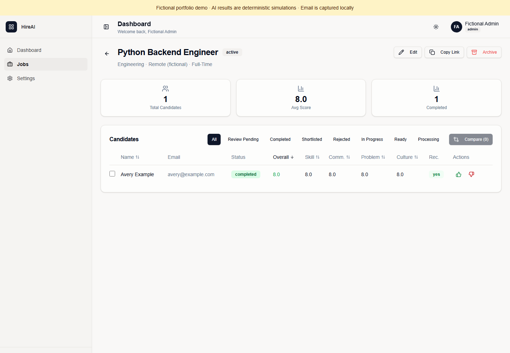
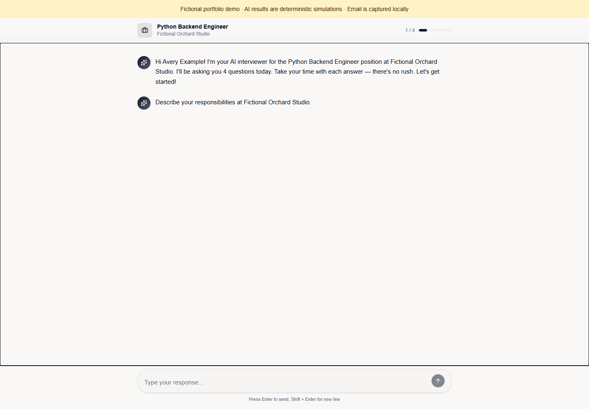
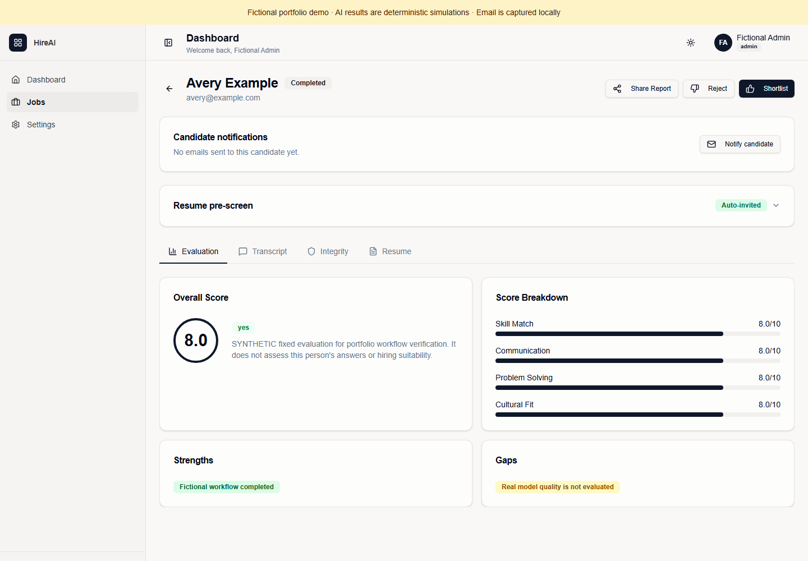
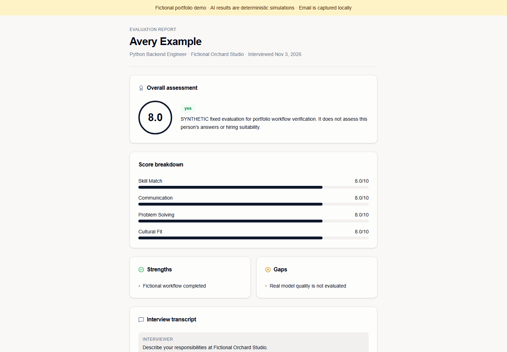
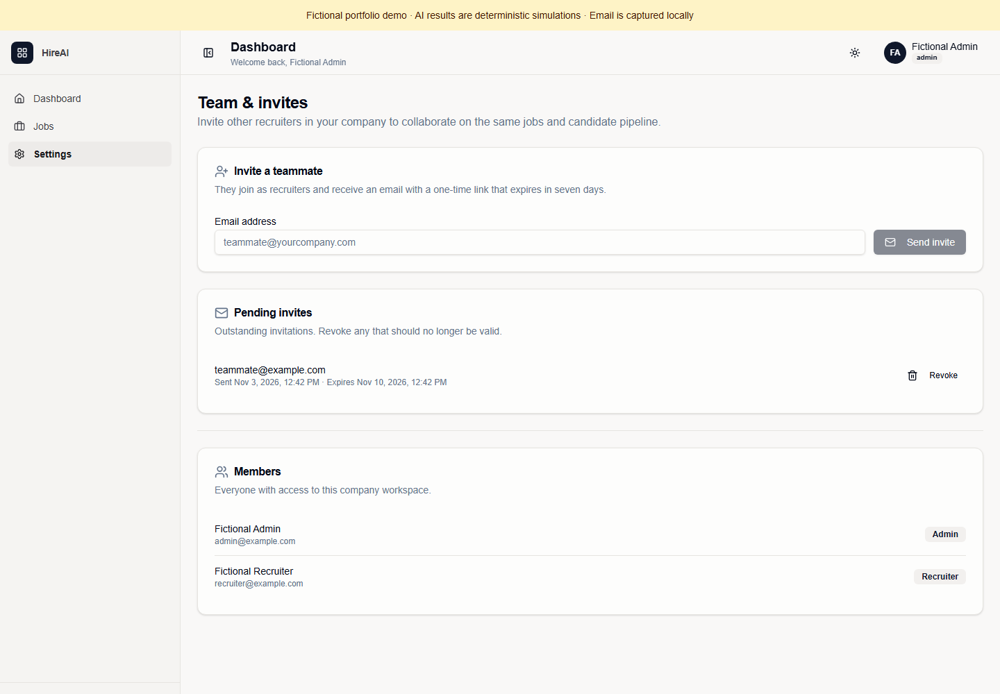
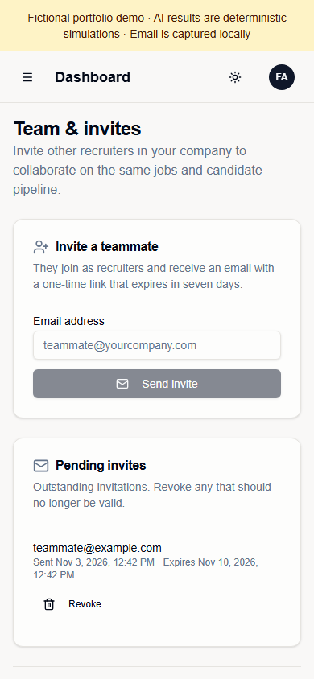

# Fictional screenshot gallery and provenance

All people, companies, resumes and results shown here are fictional. Scores and
replies are deterministic simulations, not live-model evaluations. These images
illustrate the UI and do not prove automated-test coverage or hiring quality.

Stage D's two analytics images were captured November 3, 2026 from its owned
fictional run and retained unchanged. Their owned-run creation and cleanup were verified locally.

Stage F images were captured November 3, 2026 from new owned Windows demo runs
`stage-f-visuals` and `stage-f-interview`, using the existing Playwright/Chromium
installation and real application controls through the custom frontend proxy.
No completed candidate/evaluation records were inserted for the captures. The
supplied `strong.pdf` fixture was submitted through the form; the captured
mailbox supplied the normally generated invitation. No real resume, mailbox,
paid AI or external email was used.

Only app viewport pixels were captured: no browser chrome, token-bearing URL,
credentials or personal desktop. No image-generation tool, invented UI overlay,
or retouching was used. Team screenshots use reserved-domain addresses; the
empty input's placeholder is application UI, not an actual recipient. Metadata
and pixels were inspected; current-source scanning includes these PNGs. Temporary
browser contexts and named runs were closed/cleaned; with authenticated stop.

| Asset | Viewport | Capture/content |
| --- | --- | --- |
| analytics-desktop.png | Retained image: 1265 × 712 | Stage D, two applications, completed/shortlisted workflow |
| analytics-narrow.png | Retained image: 375 × 812 | Stage D, narrow analytics stacked vertically; D recorded a 390-pixel browser viewport |
| pipeline-desktop.png | 1440 × 1000 | Stage F, one completed Avery Example application |
| interview-desktop.png | 1440 × 1000 | Stage F, fictional interview with a ready question |
| evaluation-desktop.png | 1440 × 1000 | Stage F, explicitly synthetic fixed 8/10 evaluation |
| report-desktop.png | 1440 × 1000 | Stage F, public report subset, later revoked |
| team-desktop.png | 1440 × 1000 | Stage F, pending recruiter invitation and fictional members |
| team-narrow.png | 390 × 844 | Stage F, stacked invitation controls; membership is below fold |

Counts differ between D and F because they are separate runs, not one timeline.
Inspection found that D's retained files are JPEG-encoded despite their `.png`
names; their bytes/names are preserved. Only ordinary JFIF density/version metadata
is present. All six F files are PNG-encoded with no textual metadata.
Desktop evaluation/report text and team controls were inspected. Narrow team
and analytics views are readable with scrolling. The pre-G interview check reproduced banner/header overlap but found the composer
reachable by ordinary scrolling and keyboard input. The focused fix accounts for
the measured disclosure height and keeps automatic scrolling inside the transcript.
The desktop interview image was replaced from fresh owned run `pre-g-after` on
November 3, 2026; other images are unchanged. Chromium verified 1440×1000 and
390×844 views, header separation, visible controls, hit testing and keyboard focus.
The new image includes the real message-pane keyboard focus outline. No retouching.
The narrow review capture remains private, outside the manifest. Both before/after
runs were stopped through authenticated cleanup and their directories removed.
No broad responsive or accessibility certification is claimed. See
[quality checks](../../quality-checks.md) and
[third-party inventory](../../third-party-inventory.md).

Stage D synthetic analytics, retained as historical visual evidence.

Stage D narrow-screen synthetic analytics.

Stage F fictional candidate pipeline through normal application/interview flow.

Pre-G refreshed interview; simulated replies, real interview controls.

Stage F evaluation; no claim about real answer quality.

Stage F report; its access link was revoked after capture.

Stage F administrator view; email captured locally.

Stage F narrow-screen team view; scroll for membership below.
