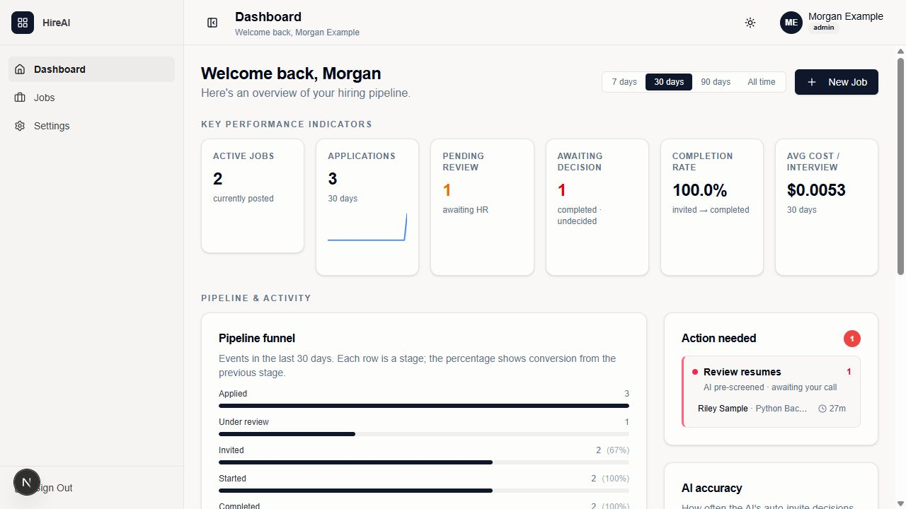
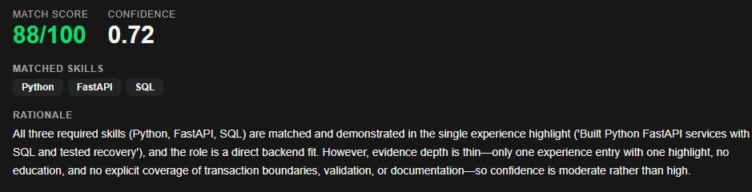
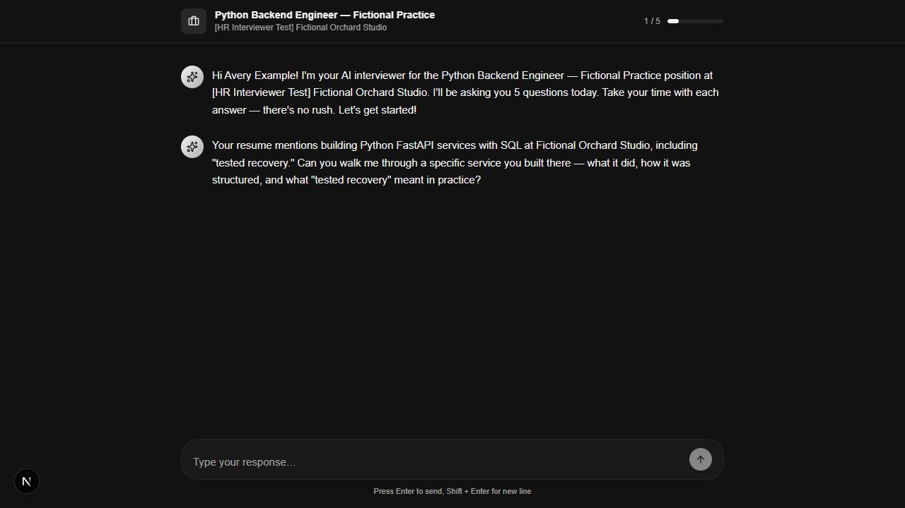
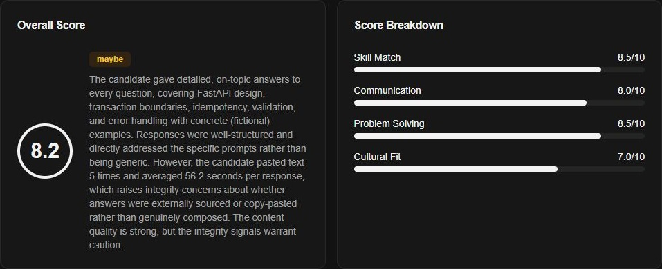
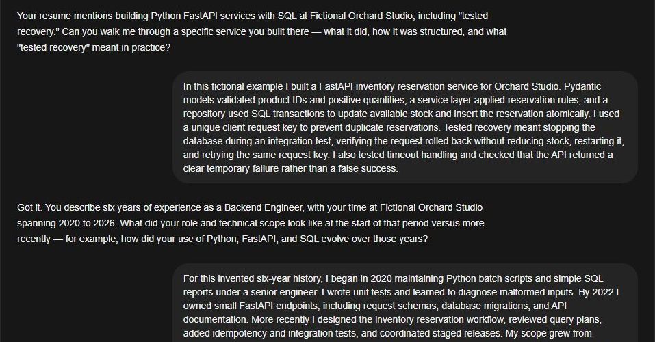
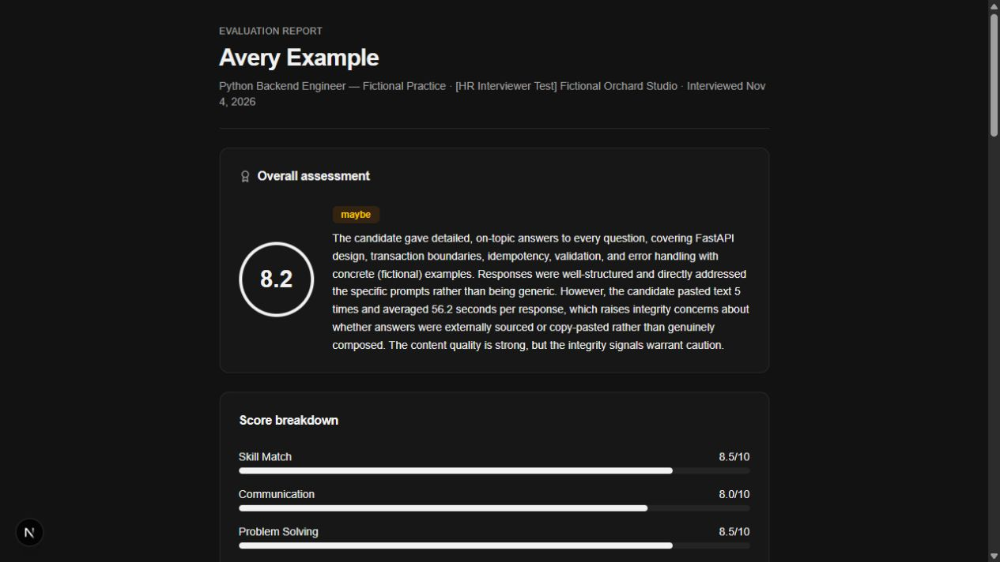
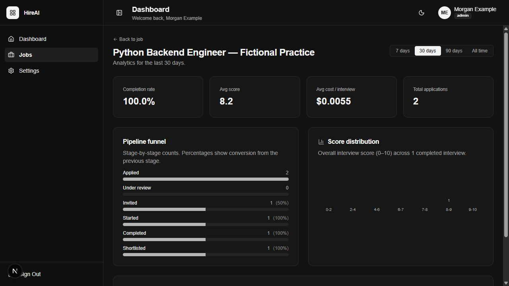

# Real-provider screenshot provenance

Fictional candidate data; real DeepSeek responses.

Captured November 4, 2026 (Asia/Manila) in the Codex integrated browser, from an
isolated ordinary-mode Windows/SQLite run through the supplied frontend proxy.
`PORTFOLIO_DEMO=false`; the selected provider/model was DeepSeek `deepseek-flash`,
with no fallback. These are saved results from actual requests, not fixed demo
responses. The model alias may change; no returned model-version identifier was
retained. [Provider coverage limits](../../real-provider-setup.md#troubleshooting-and-evidence).

All names, companies, resumes and answers are invented. The assistant submitted
the answers. The mailbox owner confirmed receiving/opening their separate test
invitation and then explicitly delegated its completion to the assistant; they
are not represented as a real job applicant. The primary screenshots use Avery
Example's practice record. Neither score nor recommendation establishes hiring
validity. Results vary between requests.

The browser used its default 1280 × 720 viewport, without an explicit responsive
override. Only application pixels were captured. The report capture returned
1265 × 712 pixels. Captures were JPEG-encoded by the browser tool and converted
to actual PNG files without further resizing or changes to decoded pixels.
The three crops below exclude contact fields; there is no pixel masking,
retouching, generated overlay or alteration of scores, answers or outcomes.

| Asset | Exported size | Scenario and framing |
| --- | --- | --- |
| dashboard.png | 1280 × 720 | Full viewport after the dashboard-label fixes; 3 applications, 2 completed interviews, 1 pending review and 1 awaiting decision before the remaining rejections. |
| screening.png | 939 × 240 | Scrolled candidate review, crop at x=293/y=239: score 88, confidence 0.72, skills and rationale. Contact/identity-warning area excluded. |
| interview.png | 1280 × 720 | Full viewport, active practice interview at question 1 of 5, before answers. |
| evaluation.png | 957 × 390 | Scrolled employer detail, crop at x=284/y=90: original 8.2 score, maybe recommendation, complete summary and dimension scores. |
| transcript.png | 957 × 500 | Scrolled saved transcript, crop at x=284/y=162: first question/answer and part of the second exchange. More transcript exists below. |
| report.png | 1265 × 712 | Returned application viewport image of the shared report; more report content exists below. Its link was revoked and the unavailable state verified. |
| analytics.png | 1280 × 720 | Full viewport of the practice job after the pre-screen rejection: 2 applications, 1 completed interview, average 8.2. |

Screenshots represent different stages, not a simultaneous final database snapshot.
The resume fixture used a reserved-domain contact while the invitation used the
approved test mailbox; the app correctly surfaced identity mismatch warnings and
held the application for human review. The screening crop excludes those warnings
because they contain the mailbox. This crop does not imply an identity match.
Evaluation/report images preserve the model's paste-related caution. Pasting was
part of this assisted test; those signals are not proof of misconduct.

Each exported image was visually inspected for the mailbox, account identifiers,
capability URLs, credentials, browser chrome, desktop and unrelated inbox content;
none is visible. PNG exports contain no EXIF/XMP data. Current-source secret
scanning covers selected images and metadata but does not replace visual review.
App cost cards are approximate legacy accounting, not the independent acceptance
budget ledger. Raster images contain UI icons and rendered glyphs, not font
programs; exact platform glyph identity was not captured. Existing
[third-party notices and limits](../../third-party-inventory.md) apply.

Commit review on November 4 re-inspected all seven exported PNGs. No email address,
private identifier, token/capability URL, credential or browser chrome is visible.
The in-page Next development indicator is visible in full-viewport images; it is
not browser chrome. No image bytes, scores, responses or framing were changed in
that review. Original JPEG-to-PNG pixel equivalence remains the capture run's
recorded evidence, not a newly repeated comparison against deleted originals.

Fictional candidate data; real DeepSeek responses.

Fictional candidate data; real DeepSeek responses.

Fictional candidate data; real DeepSeek responses.

Fictional candidate data; real DeepSeek responses.

Fictional candidate data; real DeepSeek responses.

Fictional candidate data; real DeepSeek responses.

Fictional candidate data; real DeepSeek responses.
